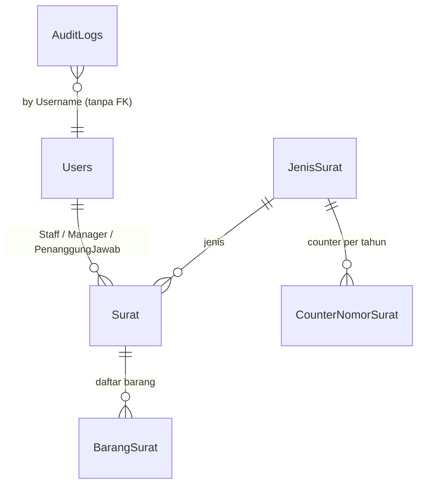

# Model Data Docuflow

Sumber: `INFORMATION_SCHEMA.COLUMNS` pada `DocuflowDB` (SQL Server Express,
`localhost\SQLEXPRESS`) dan kelas di `Docuflow_projectIT-KPB/Models/`.
Diverifikasi 2026-07-27. EF Core 10.0.3, code-first, 10 migration.

## Diagram relasi

## Kamus data

### Users
| Kolom | Tipe | Null | Catatan |
|---|---|---|---|
| Id | int | ✗ | PK identity |
| Nama | nvarchar(max) | ✗ | |
| Role | nvarchar(max) | ✗ | `Admin`, `Manager`, `Staff`, `PenanggungJawab` — dibandingkan sebagai string |
| TtdImagePath | nvarchar(max) | ✓ | **tidak dipakai** view mana pun |
| NomorPegawai | nvarchar(max) | ✗ | |
| Npk | nvarchar(max) | ✓ | |
| Username | nvarchar(max) | ✗ | tidak ada unique index — duplikat dicegah di controller saja |
| Password | nvarchar(max) | ✗ | hash BCrypt (`$2a$`/`$2y$`); plaintext diterima lalu di-upgrade saat login pertama |

### JenisSurat
| Kolom | Tipe | Null | Catatan |
|---|---|---|---|
| Id | int | ✗ | PK |
| NamaJenis | nvarchar(max) | ✗ | **wajib format `"KODE - Keterangan"`** — teks sebelum `-` dipakai sebagai kode nomor surat |
| Kode | nvarchar(max) | ✗ | tidak dipakai `NomorSuratService`; kode diambil dari `NamaJenis` |

### Surat
| Kolom | Tipe | Null | Catatan |
|---|---|---|---|
| Id | int | ✗ | PK |
| NomorSurat | nvarchar(max) | ✗ | hasil `NomorSuratService` |
| JenisSuratId | int | ✗ | FK → JenisSurat |
| Tanggal | datetime2 | ✗ | |
| CreatedAt | datetime2 | ✓ | dipakai untuk urutan di `Surat/Index` |
| Deskripsi, Tujuan, FormatSerahTerima | nvarchar(max) | ✓ | `FormatSerahTerima` tidak dirender template |
| JenisTiket, NoTiket | nvarchar(max) | ✓ | `JenisTiket` hanya `Tiket MySSC` / `Tiket BAST` di form |
| NamaPenanggungJawab, Jabatan, FungsiDirektorat, NoPekerja, Alamat | nvarchar(max) | ✓ | data teks bebas, terpisah dari relasi `PenanggungJawabId` |
| YangMenerima | nvarchar(max) | ✓ | nama, bukan FK |
| StaffId, ManagerId, PenanggungJawabId | int | ✓ | FK → Users |
| FilePath | nvarchar(max) | ✓ | relatif, contoh `/uploads/xxx.pdf` |

Catatan: penanggung jawab tersimpan **dua kali** — sebagai teks
(`NamaPenanggungJawab`, `Jabatan`, …) dan sebagai relasi (`PenanggungJawabId`).
Template PDF memakai yang teks; relasi diisi otomatis oleh controller. Keduanya
bisa tidak sinkron.

### BarangSurat
| Kolom | Tipe | Null | Catatan |
|---|---|---|---|
| Id | int | ✗ | PK |
| SuratId | int | ✗ | FK → Surat |
| NamaBarang | nvarchar(max) | ✗ | |
| Jumlah | int | ✓ | peninggalan, digantikan `SerialNumber` |
| SerialNumber, MerkType, Pengguna | nvarchar(max) | ✗ | non-null di DB, tapi form bisa kirim string kosong |

### CounterNomorSurat
| Kolom | Tipe | Null | Catatan |
|---|---|---|---|
| Id | int | ✗ | PK |
| JenisSuratId | int | ✗ | FK |
| Tahun | int | ✗ | |
| NomorTerakhir | int | ✗ | dinaikkan tiap surat dibuat |

Tidak ada unique constraint pada `(JenisSuratId, Tahun)` — dua baris untuk
kombinasi yang sama akan membuat nomor surat bentrok.

### AuditLogs
| Kolom | Tipe | Null | Catatan |
|---|---|---|---|
| Id | int | ✗ | PK |
| Username | nvarchar(max) | ✗ | teks, **tanpa FK** ke Users |
| Aktivitas | nvarchar(max) | ✗ | `Login`, `Logout`, `Generate Nomor Surat`, `Hapus Surat` |
| Deskripsi | nvarchar(max) | ✗ | |
| Waktu | datetime2 | ✗ | |

## Catatan struktural

- **Semua kolom teks `nvarchar(max)`.** Tidak ada satu pun `MaxLength` di model,
  jadi EF membuat semuanya LOB. Ini mencegah index pada `Username` /
  `NomorSurat`, dan boros untuk kolom sependek `Role`.
- **Tidak ada index selain PK dan FK.** Pada volume kecil belum terasa;
  `Surat/Index` mengurutkan `CreatedAt` tanpa index.
- **`BarangSurat` tidak punya controller atau view sendiri.** Baris hanya lahir
  dari `SuratController.Create`, dan tidak ada jalur edit/hapus per barang.

## Data uji

`db/seed-testing.sql` mengisi: 5 JenisSurat, 16 user baru (total 17), 18 Surat,
73 BarangSurat, 5 CounterNomorSurat, 32 AuditLog. Password seluruh user hasil
seed dicantumkan di header skrip itu sendiri (tidak ditulis di sini karena repo ini publik).
