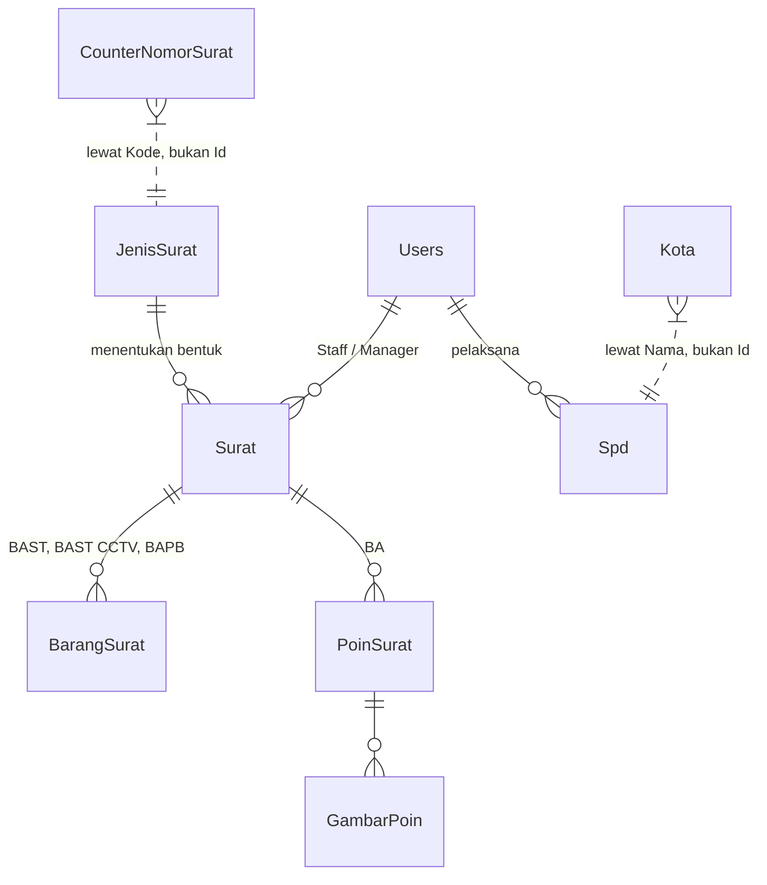

# Model Data Docuflow

Diambil dari `INFORMATION_SCHEMA` pada `DocuflowDB` **2026-09-09**, bukan dari
membaca kelas model. Kalau keduanya berbeda, yang benar adalah basis data.

## Peta hubungan

Dua garis putus-putus itu **sengaja bukan foreign key**:

- `CounterNomorSurat` dikunci pada **`Kode`**, bukan `JenisSuratId`. Beberapa
  jenis berbagi satu kode (dua BAST, dua BA, tiga BAPB), dan counter per jenis
  akan memberi masing-masing `001` — nomor dokumen kembar di tingkat yang
  berbeda.
- `Spd` menyimpan **nama** kota sebagai teks. Kemendagri menomori ulang wilayah,
  dan SPD yang sudah terbit tidak boleh berubah arti ketika itu terjadi. Alasan
  yang sama dengan `Users.Jabatan`.

## Tabel

### Surat — dokumen berita acara

| Kolom | Tipe | | Catatan |
|---|---|---|---|
| `Id` | int | PK | |
| `NomorSurat` | nvarchar(max) | | `BAST 146/KPB3240/2026-S0`. Terbit sekali, tidak pernah diubah |
| `JenisSuratId` | int | FK | menentukan template cetak dan bagian formulir |
| `Tanggal` | datetime2 | | tanggal pada dokumen. Menentukan tahun nomor **dan** tahun arsip |
| `CreatedAt` | datetime2 | NULL | |
| `Deskripsi` | nvarchar(max) | NULL | pada BALP berarti "Keterangan BALP" |
| `Tujuan` | nvarchar(max) | NULL | pihak lawan. Pada BAPB bisa pengirim **atau** penerima, tergantung jenis |
| `Tentang` | nvarchar(300) | NULL | judul, hanya BA Survey |
| **Penanggung jawab** | | | orang yang tercetak di atas tabel barang |
| `NamaPenanggungJawab` | nvarchar(max) | NULL | |
| `Jabatan` | nvarchar(max) | NULL | diketik di formulir — orang ini umumnya bukan pengguna aplikasi |
| `FungsiDirektorat` | nvarchar(max) | NULL | |
| `NoPekerja` | nvarchar(max) | NULL | |
| `Alamat` | nvarchar(max) | NULL | |
| **Penanda tangan** | | | |
| `StaffId` | int | FK NULL | kotak "Yang Menyerahkan" |
| `ManagerId` | int | FK NULL | kotak "Mengetahui" |
| `YangMenerima` | nvarchar(max) | NULL | teks bebas — pihak lawan sering tanpa akun |
| `JabatanYangMenerima` | nvarchar(120) | NULL | opsional; kosong tidak mencetak baris |
| **Dasar pemenuhan** | | | hanya dicetak BAST |
| `JenisTiket` | nvarchar(max) | NULL | `Tiket MySSC` atau `Nomor Memo` |
| `NoTiket` | nvarchar(max) | NULL | |
| **Lampiran** | | | |
| `FilePath` | nvarchar(max) | NULL | relatif, `/uploads/...` |
| `TanggalBalp` | datetime2 | NULL | tanggal pada surat vendor. **Sengaja terpisah dari `Tanggal`** |
| **Mati** | | | |
| `PenanggungJawabId` | int | NULL | konsepnya dihapus 2026-09-03; kolomnya disisakan supaya tidak butuh migration |
| `FormatSerahTerima` | nvarchar(max) | NULL | tidak dibaca siapa pun |

### BarangSurat — satu tabel, tiga set kolom

Set kolom dipilih menurut **nama jenis**, bukan kode.

| Kolom | Tipe | BAST | BAST CCTV | BAPB |
|---|---|:--:|:--:|:--:|
| `NamaBarang` | nvarchar(max) | ● | ● | |
| `SerialNumber` | nvarchar(max) | ● | | ● |
| `MerkType` | nvarchar(max) | ● | | ● |
| `Pengguna` | nvarchar(max) | ● | | |
| `Tanggal` | nvarchar(100) | | ● | |
| `Jam` | nvarchar(100) | | ● | |
| `Rekaman` | nvarchar(300) | | ● | |
| `Area` | nvarchar(200) | | ● | |
| `Jumlah` | int | | | ● |
| `Satuan` | nvarchar(20) | | | ● |
| `Keterangan` | nvarchar(300) | | | ● |

`Tanggal` dan `Jam` **string, bukan datetime**: satu baris rutin memuat rentang
(`"1 - 15 Agustus 2026"`, `"08:00 - 17:00 WITA"`).

Kolom JUMLAH-dalam-huruf pada BAPB **tidak disimpan** — dihitung `Terbilang.cs`
saat cetak. Salinan tersimpan bisa berbeda dengan angkanya setelah diubah.

### PoinSurat — laporan bertingkat, untuk BA

| Kolom | Tipe | Catatan |
|---|---|---|
| `Id` | int | PK |
| `SuratId` | int | FK |
| `Level` | int | 0–2 |
| `Urutan` | int | |
| `Judul` | nvarchar(300) | |
| `Keterangan` | nvarchar(max) | NULL |

**Outline, bukan pohon ber-`ParentId`.** Induk sebuah poin adalah baris terdekat
di atasnya yang `Level`-nya lebih kecil. Dokumennya memang daftar bersarang,
jadi `Level` + `Urutan` sudah memuat seluruh strukturnya: tidak mungkin ada
siklus, dan tidak perlu query rekursif.

Penomoran 1 / 1.1 / 1.1.1 dihitung dari urutan itu dan **tidak pernah disimpan**,
supaya tidak bisa basi setelah sisip atau hapus.

### GambarPoin

| Kolom | Tipe | Catatan |
|---|---|---|
| `PoinSuratId` | int | FK |
| `FilePath` | nvarchar(400) | `/uploads/...` |
| `Urutan` | int | |

Baris ikut terhapus lewat cascade; **berkas fisiknya tidak**. `SuratController`
yang membuangnya dari disk pada Hapus dan pada Ubah.

### Users

| Kolom | Tipe | Catatan |
|---|---|---|
| `Username` | nvarchar(max) | |
| `Password` | nvarchar(max) | hash BCrypt. Nilai yang tidak diawali `$2` diperlakukan sebagai teks biasa lalu dinaikkan jadi BCrypt saat login berhasil pertama |
| `Nama` | nvarchar(max) | |
| `Role` | nvarchar(max) | **akses saja**: `SuperAdmin` atau `Admin`. Bertingkat, bukan terpisah |
| `Jabatan` | nvarchar(120) | NULL — jabatan sebenarnya, ikut tercetak. Menggantikan `PosisiTtd` 2026-09-03 |
| `NomorPegawai` | nvarchar(max) | non-nullable |
| `Npk` | nvarchar(max) | NULL — **duplikat `NomorPegawai`, tidak dipakai** |
| `TtdImagePath` | nvarchar(max) | NULL — **tidak dipakai view mana pun** |

**Peran tanda tangan tidak disimpan, dihitung.** `Services/JabatanUser` memegang
aturannya: `JabatanUser.AstManager` → kotak "Mengetahui", jabatan lain yang
tidak kosong → kotak Staff, kosong → tidak menandatangani. Menyimpan peran
*dan* jabatan membuka peluang keduanya bertentangan.

### CounterNomorSurat

| Kolom | Tipe | Catatan |
|---|---|---|
| `Kode` | nvarchar(20) | **bukan `max`** — kunci index tidak boleh `nvarchar(max)` |
| `Tahun` | int | |
| `NomorTerakhir` | int | nomor **terakhir terpakai**, bukan berikutnya |

Index unik `(Kode, Tahun)`. Selain mencegah baris kembar, index itu memberi
`HOLDLOCK` rentang kunci saat barisnya belum ada.

Tahun berganti sendiri: `GenerateNomorSurat` membaca `DateTime.Now.Year` sekali
dan memakainya untuk kunci counter **dan** teks nomornya, jadi dokumen pertama
2027 tidak menemukan baris `(Kode, 2027)`, membuatnya di 1, lalu mencetak
`.../2027-S0`.

### Spd, Kota, JenisSurat, AuditLogs

| Tabel | Kolom penting |
|---|---|
| `Spd` | `NomorSpd` nvarchar(60) · `StaffId` FK · `NamaKota` + `Provinsi` teks · `Keperluan` nvarchar(500) · `TanggalDinas` |
| `Kota` | `Nama` nvarchar(120) **unik** — pencocokan dilakukan atas nama · `Provinsi` · `Kode` |
| `JenisSurat` | `Kode` (sumber kode pada nomor) · `NamaJenis` (sumber aturan per jenis) |
| `AuditLogs` | `Username` · `Aktivitas` · `Deskripsi` · `Waktu` |

## Catatan struktural

- **Sebagian besar kolom teks masih `nvarchar(max)`** dan tidak bisa di-index.
  Kolom yang lahir belakangan sudah dibatasi. Menyempitkan yang lama butuh
  migration dan belum dikerjakan.
- **Tidak ada yang menerapkan migration saat startup.** `Program.cs` tidak
  memanggil `Database.Migrate()`; deploy tidak pernah mengubah skema.
- 21 migration. Skema dari nol dibangun lewat `dotnet ef migrations script
  --idempotent`, dan sejak 2026-09-08 skrip itu **bisa** dijalankan — sebelumnya
  gagal karena `migrationBuilder.Sql` menyebut kolom yang baru ditambahkan pada
  batch yang sama.
