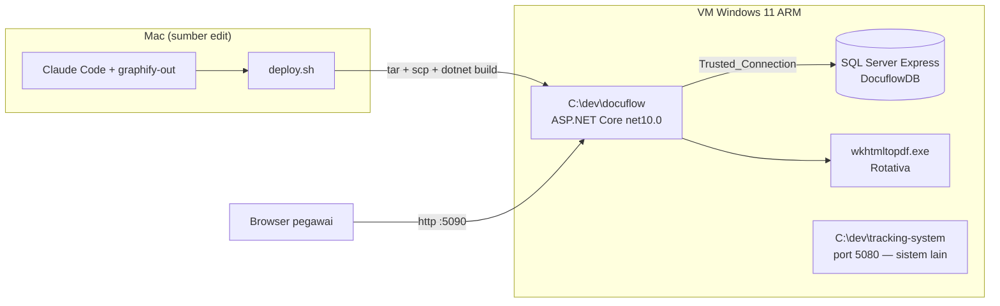
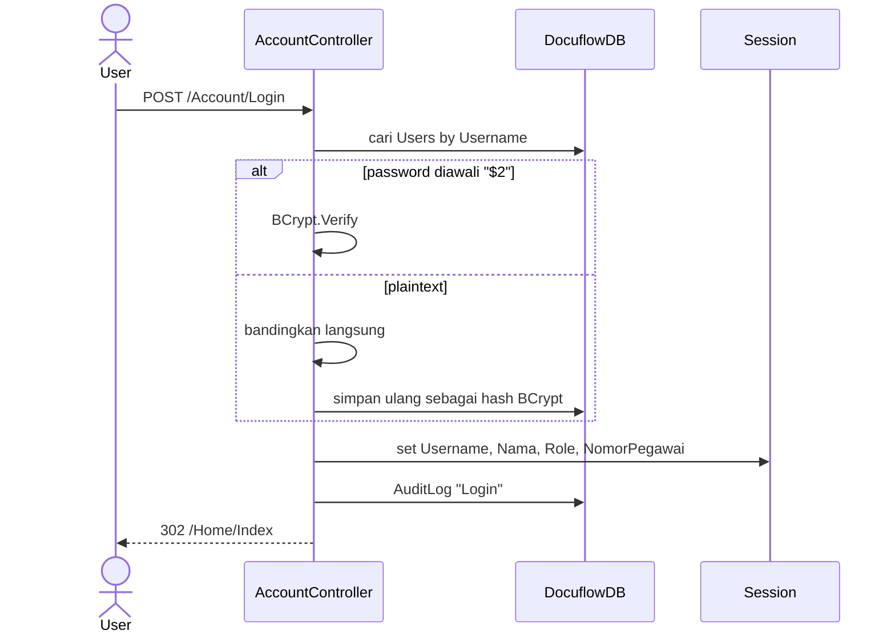
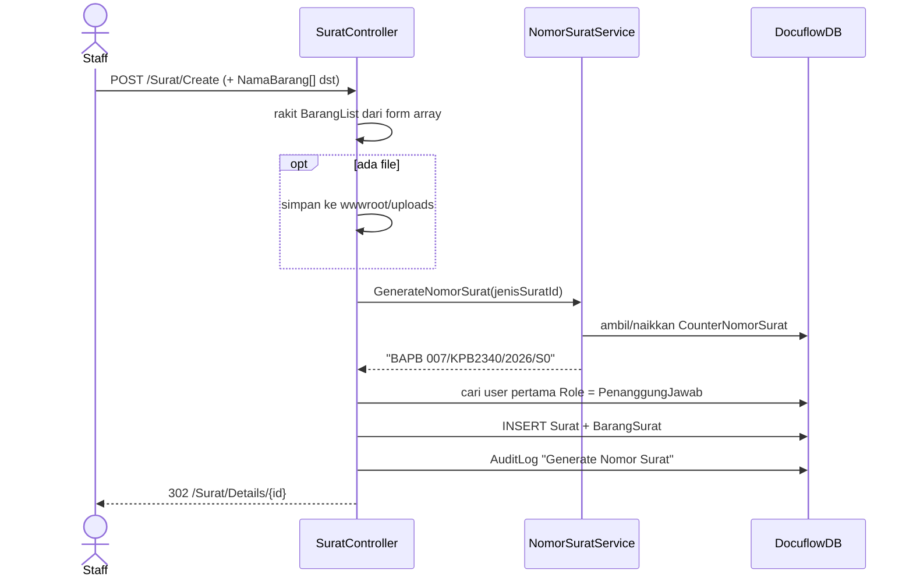
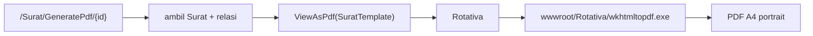
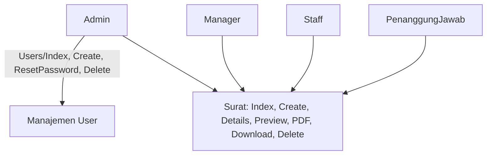

# Diagram Docuflow

Semua diagram di bawah menggambarkan **kondisi kode saat ini**, bukan rancangan
ideal. Diverifikasi 2026-07-27.

## 1. Konteks & deployment

Windows wajib karena dua hal: `wkhtmltopdf.exe` (binary Windows-only) dan
`Trusted_Connection=True` (Windows Authentication ke SQL Server).

## 2. Alur login

Proteksi route lewat `Filters/SessionAuthorizeAttribute.cs`. Cek admin dilakukan
dengan membandingkan string `Session["Role"] == "Admin"` di dalam action, bukan
lewat atribut.

## 3. Alur pembuatan surat

**Format nomor:** `{KODE} {NNN}/KPB2340/{tahun}/S0`, dengan `KODE` = teks sebelum
`-` pada `JenisSurat.NamaJenis`, dan `NNN` = `NomorTerakhir` 3 digit.

Titik rapuh yang sudah terlihat:
- Nomor diambil **sebelum** `SaveChanges` surat. Kalau insert gagal, counter
  sudah terlanjur naik dan satu nomor hilang.
- Tidak ada penguncian; dua staff yang submit bersamaan bisa dapat nomor sama.
- Penanggung jawab diambil dengan `FirstOrDefaultAsync` tanpa urutan — user
  `PenanggungJawab` mana yang terpilih tidak deterministik.

## 4. Alur cetak PDF

`/Surat/Preview/{id}` merender template yang sama sebagai HTML — berguna untuk
mengecek tata letak tanpa memanggil wkhtmltopdf.

`/Surat/Download/{id}` mengembalikan lampiran asli kalau `FilePath` terisi;
kalau kosong, redirect ke `GeneratePdf`. Path lampiran diselesaikan lewat
`Directory.GetCurrentDirectory()`, jadi **working directory aplikasi harus folder
project**.

## 5. Peran dan hak akses

Semua peran yang sudah login punya akses **sama persis** ke seluruh menu Surat —
termasuk `Delete`. Tidak ada pembatasan per peran di `SuratController`.
