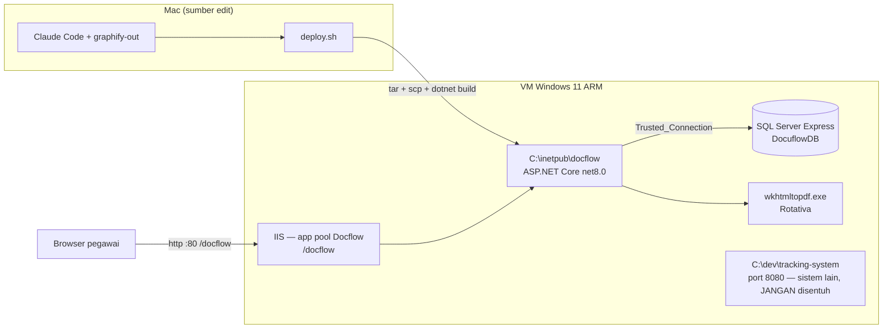
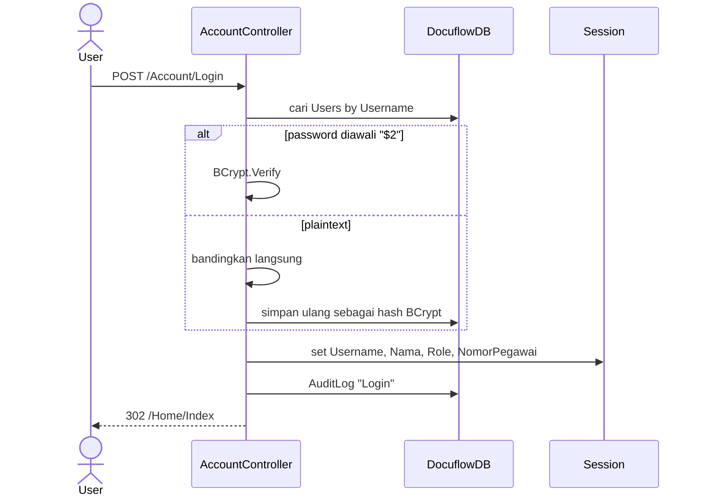
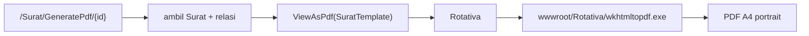
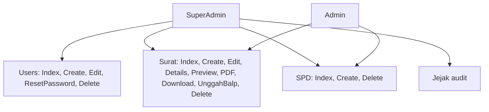

# Diagram Docuflow

Diperbarui **2026-09-09**.

Semua diagram di bawah menggambarkan **kondisi kode saat ini**, bukan rancangan
ideal. Diverifikasi 2026-07-27.

## 1. Konteks & deployment

Windows wajib karena dua hal: `wkhtmltopdf.exe` (binary Windows-only) dan
`Trusted_Connection=True` (Windows Authentication ke SQL Server).

**Kestrel di port 5090 sudah pensiun** (2026-08-06). IIS satu-satunya jalur.
Dulu keduanya berbagi satu basis data tapi punya `wwwroot/uploads` masing-masing,
sehingga lampiran yang diunggah lewat satu jalur jadi gambar rusak di jalur
lainnya.

## 2. Alur login

Proteksi route lewat `Filters/SessionAuthorizeAttribute.cs`, yang menerima
`params string[]` — memperluas sebuah controller cukup menambah satu argumen.
Pemeriksaan peran ada di atribut controller, **bukan** di `if` per action.

## 3. Alur pembuatan surat

**Format nomor:** `{KODE} {NNN}/KPB3240/{tahun}-S0` — mis.
`BAST 146/KPB3240/2026-S0`. `KODE` diambil dari **kolom** `JenisSurat.Kode`
(sejak 2026-08-06 tidak lagi diurai dari `NamaJenis`), dan `NNN` adalah
`NomorTerakhir + 1` dalam 3 digit.

Tanpa `No.` di antara kode dan angkanya: sistem lama menulis
`BAPB 027/KPB3240/2024-S0`, dan Docuflow melanjutkan deret yang sama.

Titik rapuh yang sudah terlihat:
- Nomor diambil **sebelum** `SaveChanges` surat. Kalau insert gagal, counter
  sudah terlanjur naik dan satu nomor hilang.
- Tidak ada penguncian; dua staff yang submit bersamaan bisa dapat nomor sama.
- Penanggung jawab diambil dengan `FirstOrDefaultAsync` tanpa urutan — user
  `PenanggungJawab` mana yang terpilih tidak deterministik.

## 4. Alur cetak PDF

`/Surat/Preview/{id}` merender template yang sama sebagai HTML — berguna untuk
mengecek tata letak tanpa memanggil wkhtmltopdf.

`/Surat/Download/{id}` mengembalikan lampiran asli kalau `FilePath` terisi;
kalau kosong, redirect ke `GeneratePdf`. Path lampiran diselesaikan lewat
`Directory.GetCurrentDirectory()`, jadi **working directory aplikasi harus folder
project**.

## 5. Peran dan hak akses

Dua peran, **bertingkat bukan terpisah** (diubah 2026-09-03). Super Admin adalah
superset; satu-satunya pintu yang tetap searah adalah `Users/*`.

`Jabatan` berbeda dari `Role`: `Role` menjawab "boleh membuka apa", `Jabatan`
menjawab "siapa orang ini" dan ikut tercetak. Peran tanda tangan **dihitung**
dari jabatan lewat `Services/JabatanUser`, tidak disimpan.
